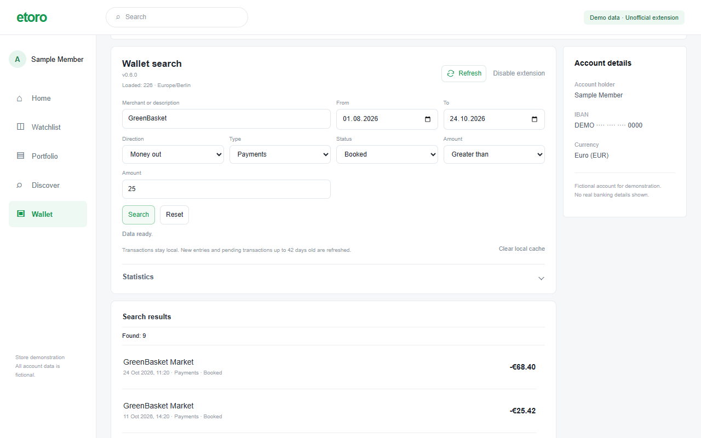

# eToro Wallet Search

[Project website](https://yadimon.github.io/etoro-wallet-search/) ·
[Download](https://github.com/yadimon/etoro-wallet-search/releases) ·
[Privacy](https://yadimon.github.io/etoro-wallet-search/privacy.html) ·
[Support](https://yadimon.github.io/etoro-wallet-search/support.html)



An unofficial Chrome Manifest V3 extension and Tampermonkey script for searching
and viewing transactions inside eToro Wallet. It also provides expandable monthly
statistics. It performs no payments, transfers or account-setting changes.

- [Features, installation and data behavior](wallet-search/README.md)
- [Architecture and development](wallet-search/docs/ARCHITECTURE.md)
- [Security model and reporting](SECURITY.md)
- [Code audit and remaining limitations](wallet-search/docs/CODE-AUDIT.md)
- [Privacy policy](wallet-search/docs/PRIVACY.md)
- [License and commercial use](COMMERCIAL.md)
- [Chrome Web Store publication, step by step (German)](wallet-search/docs/PUBLISH.de.md)
- [Contributing](CONTRIBUTING.md)

## Development

Use Node.js 22 or newer and npm. All runtime extension code is packaged locally;
npm dependencies are development tools and are not included in the extension.

```text
npm ci
npx playwright install chromium
npm run test:wallet:all
npm run check:wallet:format
```

Builds update both `dist/chrome-extension` and
`dist/etoro-wallet-search-extension`. Load the directory containing `manifest.json`
as an unpacked extension. Do not enable the userscript at the same time.

## License

Copyright 2026 Dmitry Gorelenkov. This project is **source available** under
[PolyForm Noncommercial 1.0.0](LICENSE). Use, changes and distribution are allowed
for the license's permitted purposes. Commercial use outside those permissions
requires a separate written agreement; see [COMMERCIAL.md](COMMERCIAL.md).
The project does not claim to use an OSI-approved open-source license.

## Project pages

The static website is served from `docs/` on GitHub Pages. Update public contact
and release information in `project-site.json`, edit the privacy policy in
`wallet-search/docs/PRIVACY.md`, then run `node scripts/build-project-site.mjs`.
The pages use local assets, no external fonts, scripts, cookies or analytics.

## Reproducible source archive

`npm run package:wallet:source` produces an explicitly allowlisted source archive.
Environment files, local tooling, real exports and test receipts are excluded.

The project is not affiliated with, endorsed by or supported by eToro.
